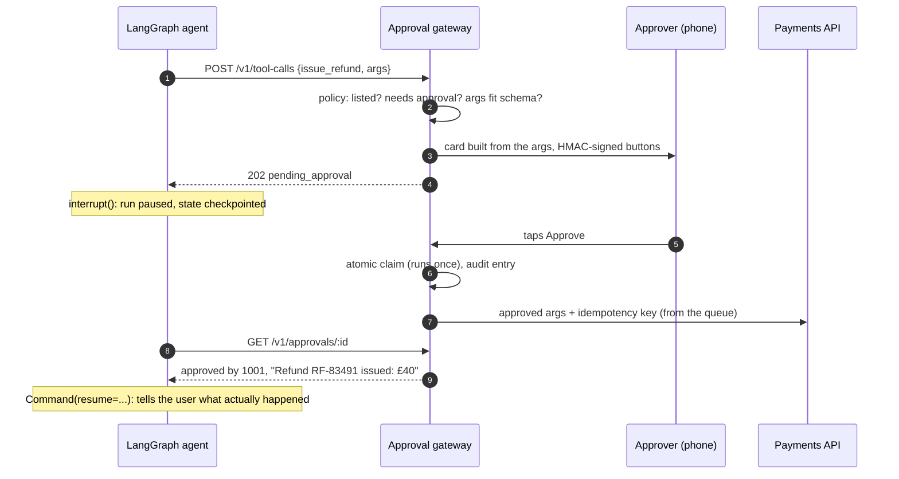

# agent-approval-gateway

**Let an AI agent ask for anything, but only let it *do* sensitive things after a named person has
approved the exact request on their phone.**

A policy gateway that sits between an AI agent and the systems it acts on. Every tool call is
checked first: read-only calls go straight through, unlisted calls are refused, and sensitive calls
(refunds, invoices) become a signed approval card. If the approver taps Approve, the gateway runs
exactly the approved arguments, once, with its own credentials, and records the decision in a
tamper-evident audit log. Includes a LangGraph agent that pauses mid-run for the decision.


*A real run, recorded live: local Qwen 2.5 7B, a real Telegram approval tapped on a phone, a stub
payments API. Frames are held so each step can be read; the approver's id is masked.*

> Framed as a forward-deployed engagement for a **fictional** UK lender, "Northgate Lending".
> The payments and customer systems are stubs. Everything else is real and tested.
> [Engagement brief](docs/engagement/brief.md) ·
> [Security questionnaire](docs/engagement/security-questionnaire.md) ·
> [Runbook](docs/engagement/runbook.md) · [Handover](docs/engagement/handover.md) ·
> [Decision records](docs/adr/)

## How it works



The agent never holds the payment credentials: sensitive tools exist in it only as schemas
([ADR 1](docs/adr/0001-gateway-runs-approved-actions.md)).

## Results

| Claim | Evidence |
|---|---|
| Tools not in the policy are refused, whatever the agent asks for | **Tested** (`test/policy.test.ts`, `test/server.test.ts`) and **seen live**: a £250,000 `wire_money` call got 403 |
| The approver sees the real arguments; the agent's wording comes last, labelled | **Tested** (`test/server.test.ts`) |
| A call that doesn't fit the tool's argument schema, or breaks a limit (refunds over £500), is refused before any card is sent | **Tested** (`test/argSchema.test.ts`) and **seen live**: 422 for wrong field names and for £4,000 |
| Forged, replayed, swapped (reject→approve) or cross-card buttons never run anything | **Tested** (`test/gate.test.ts`) |
| Each approved action runs once: double taps, two processes, retries and restarts | **Tested**, including two database connections racing the same claim (`test/store.test.ts`) |
| LangGraph re-runs the paused node on resume, yet the approver gets one card | **Tested** (`python/tests/test_graph.py`) and **seen live** (1 card for the run) |
| A paused agent run survives the agent process exiting | **Tested** with SQLite checkpoints |
| Editing, deleting or reordering any audit line is detected and located | **Tested**, including an edit with a correctly recomputed hash (`test/audit.test.ts`) |
| End to end on a phone: a local model found a duplicate £40 charge, asked to refund it, waited, and the gateway issued it once | **Seen live** (Telegram, Qwen 2.5 7B on Ollama, stub payments API) |

88 TypeScript tests (`node:test`, 97% line coverage of `src`, including an end-to-end run against a fake Telegram server) and 21 Python tests (pytest, 96% line coverage).
**Not deployed:** the Terraform in `infra/` is validated offline only.

## What broke

- **The approver approved a correct card and the payment ran with empty values.** In the first live
  run the agent sent `amount_gbp`; my demo executor read `amountGbp`. The card was right, the
  approval was right, and the stub reported "Refund issued: £undefined to customer undefined".
  Approving the exact arguments isn't enough if nothing checks they fit the executor. Fix: a
  per-tool argument schema in the policy, checked before any card exists
  ([ADR 2](docs/adr/0002-card-built-from-arguments.md)), plus executors that refuse missing values.
- **An ignored card kept the agent waiting forever.** Cards only expired when tapped. Reads now
  close stale cards, so the agent sees "expired" and the buttons disappear.
- **Resuming a LangGraph `interrupt()` re-runs the whole node.** So the agent asks the gateway a
  second time. Without an idempotency key (thread id + tool call id) that would send a second card.

## Quick start

Requires Node 22.13+, and for the agent: Python 3.12+, [uv](https://docs.astral.sh/uv/) and
[Ollama](https://ollama.com) with `qwen2.5:7b`.

```bash
npm install
npm test                      # 88 tests, no network

# Gateway with the lender's stub executors. See docs/engagement/runbook.md for every variable.
ENV_FILE=/secure/path/gateway.env npm run demo
# Console: http://127.0.0.1:8787/ (asks for the viewer key)

# Play the agent from the shell
ENV_FILE=/secure/path/gateway.env npm run agent -- issue_refund \
  '{"customer_id":"C-1042","amount_gbp":40,"reason_code":"duplicate_charge"}' "Charged twice in October"

# Or run the LangGraph agent
cd python && uv sync && uv run pytest
ENV_FILE=/secure/path/gateway.env uv run approval-agent \
  "Customer C-1042 says they were charged twice for their October instalment. Please put it right."
```

## The policy

Default-deny. Approver ids come from the environment so real ids stay out of git.

```json
{
  "version": 1,
  "approverGroups": { "finance-lead": ["env:FINANCE_APPROVER_ID"] },
  "tools": {
    "lookup_customer": { "requiresApproval": false, "args": { "customer_id": "string" } },
    "issue_refund": {
      "requiresApproval": true,
      "approvers": ["finance-lead"],
      "expiryHours": 24,
      "args": {
        "customer_id": { "type": "string", "maxLength": 20 },
        "amount_gbp": { "type": "number", "min": 0.01, "max": 500 },
        "reason_code": { "type": "string", "enum": ["duplicate_charge", "goodwill", "error_correction"] }
      }
    }
  }
}
```

## API

| Method | Path | Key scope | Returns |
|---|---|---|---|
| `POST` | `/v1/tool-calls` | agent | `200` allow · `403` deny · `422` bad arguments · `202` pending approval · `409` idempotency conflict · `502` card not delivered |
| `GET` | `/v1/approvals/:id` | agent, viewer | status, approver, outcome, execution result |
| `GET` | `/v1/approvals?status=` | viewer | the queue (console) |
| `GET` | `/v1/audit` | viewer | audit chain verification |
| `GET` | `/` | none (page asks for a viewer key) | read-only console |

Send `Idempotency-Key` on `POST /v1/tool-calls`; a retry with the same key returns the same approval.

## Design decisions

1. [The gateway runs approved actions, not the agent](docs/adr/0001-gateway-runs-approved-actions.md)
2. [Cards are built from the arguments, and arguments are checked against a schema](docs/adr/0002-card-built-from-arguments.md)
3. [SQLite with single-statement state changes](docs/adr/0003-sqlite-conditional-update.md) (and the Postgres `SKIP LOCKED` path)
4. [Hash-chained audit log](docs/adr/0004-hash-chained-audit-log.md) (and its truncation limit)
5. [No runtime dependencies in the gateway](docs/adr/0005-zero-runtime-dependencies.md)
6. [Telegram over long polling, behind a transport interface](docs/adr/0006-telegram-long-polling.md)

## Limits

Card contents pass through Telegram (swap the transport for Teams or Slack in a regulated
deployment). Single host. No encryption at rest inside the app. No two-person approval yet.
Audit tail truncation needs an external copy of the head hash. Full list in the
[security questionnaire](docs/engagement/security-questionnaire.md#known-gaps-stated-not-hidden).

## Layout

```
src/          gateway (TypeScript, Node standard library only)
test/         node:test suites
python/       LangGraph agent (uv, pytest, ruff, mypy --strict)
examples/     policy, stub executors, agent script
docs/         engagement documents and decision records
```

MIT licence. Built by Idris-Michael Bakare.
